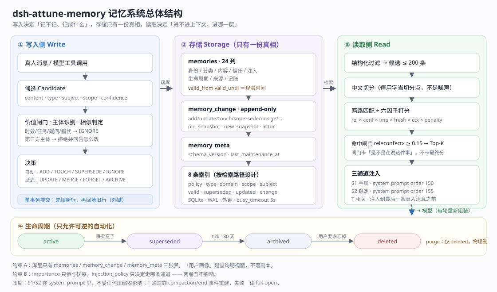

# dsh-attune-memory

[](https://github.com/Lyricxvy/dsh-attune-memory/actions/workflows/tests.yml)
[](LICENSE)

给 [DeepSeek Harness](https://github.com/deepseek-ai) 用的跨会话长期记忆。它记的不是聊天记录，而是关于一个人的稳定事实：他是谁、他在做什么、他希望怎么被回答。记忆全部存在本机 SQLite，不上传任何服务器。

引擎只依赖 Python 标准库，可以脱离宿主单独运行；插件负责把它接进模型上下文，并提供查看与修改的界面。

## 记忆原理

**记什么。** 每条记忆属于四类之一：画像、领域约定、当前状态、经历过的事。除此之外还带三个独立维度——主体（是谁的事）、作用域（在哪个话题下生效）、注入策略（是否每轮都需要）。它们互不替代，所以「很重要但很少用得上的事」可以存着而从不打扰上下文。

**怎么变。** 写入不是简单的追加。系统会先判断该忽略、新增、修正、合并、取代、归档还是删除；事实变了就把旧条目取代掉，写上失效时间与指向，旧版本永远可查。冲突不悄悄覆盖，而是并存、标注、事后可解释。

**怎么用。** 记忆从三条通道进入上下文：一条教模型何时该查记忆的常量手册；一段放在 system prompt 里的稳定事实，任何压缩都折不掉；以及每轮按当前问题检索出来的相关记忆，插在提问之前。



```
用户消息
   │
   ├─ 手册      system prompt   「什么时候该用记忆」
   ├─ 稳定事实  system prompt   常驻的画像与长期约定
   └─ 相关记忆  pre-step        按本轮问题检索，插在提问之前
                        │
                        ▼
            插件（Node） ⇄ stdio JSON-RPC ⇄ 引擎（Python + SQLite）
```

## 快速开始

```bash
git clone https://github.com/Lyricxvy/dsh-attune-memory.git
cd dsh-attune-memory/engine
python -m unittest discover -s tests
python -m eval.run_eval
```

引擎也可以直接当库用：

```python
from attune_memory import Memory

m = Memory("memory.db")
m.add("用户在做 DSH 插件开发", type="state", subtype="goal", importance="important")
print(m.read_for_context(query="DSH 插件怎么调试")["context"]["text"])
```

接入宿主需要改 profile 并重启应用，步骤见 [INSTALL.md](INSTALL.md)。

## 许可证

MIT，见 [LICENSE](LICENSE)。
