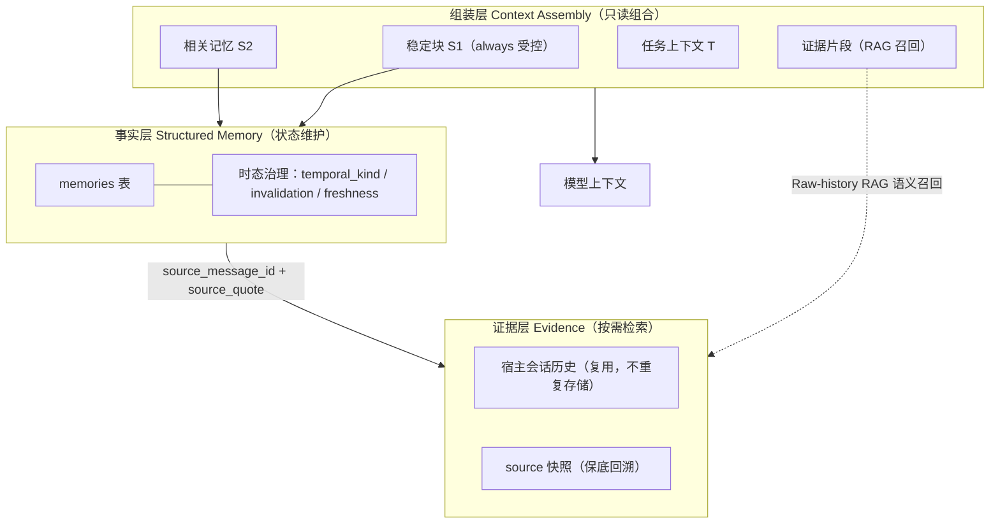
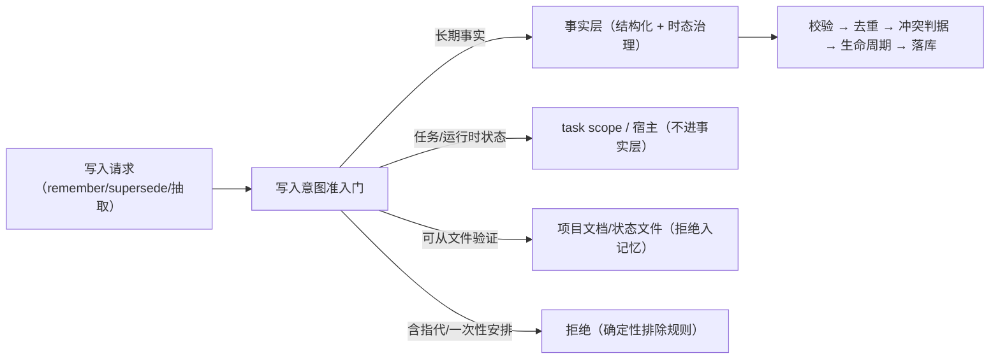
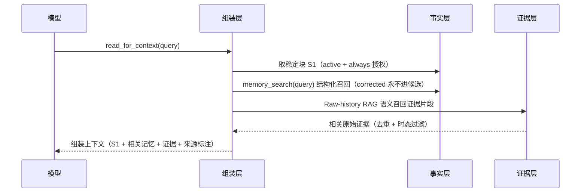

# DSH 记忆系统新一代架构设计书（DSH Memory Architecture Design · VNEXT）

> 版本：VNEXT（正式新一代架构设计，取代 v3 草案与 v0.2.0 实施计划书作为后续开发/测试/架构演进基准）
> 日期：2026-11-19
> 定位：DSH 后续开发、测试和架构演进的主要依据
> 依据：五部分资料统一交叉分析（DSH 原计划书 / ChatGPT Dreaming 研究 / Anima Brain 源码研究 / Notion 问题台账 / RAG 最新研究）
> 诚实立场：区分「已证实 / 合理推测 / 待实验 / 未知」；外部基准结果一律标注 UNVERIFIED；不虚构未公开的内部实现

---

# 1. 文档概述、版本与设计目标

## 1.1 文档目的与范围

本设计书重新制定 DSH 记忆系统的完整架构。它不是对 v0.2.0 实施计划书的简单修订，也不是五份研究报告的拼接，而是在理解 DSH 原有设计目标、实际运行状况和既有技术决策的基础上，重新审视整个记忆系统，吸收经研究和比较后真正有价值的外部机制，解决已暴露的问题，形成一套逻辑完整、职责清晰、可逐步实施、可独立验证的新架构。

本阶段只做研究、分析和设计。**不修改任何现有程序、数据库、运行逻辑或配置**。

## 1.2 与既有文档的关系

| 文档 | 关系 |
|---|---|
| v0.2.0 实施计划书 | 已完成的「架构收口」历史前提；其成果（SSOT / explicit 默认 False / 删 forget hard / 抽取四计数 / 死链闭合 / fail-closed 三态）全部保留、不推翻 |
| 记忆架构设计书-v3.md | 本设计书的中间迭代；六部分内容被重组为本文 20 章并扩充 |
| 五份研究报告（Dreaming / Anima / 台账 / RAG） | 本文第 4 章的证据来源，不做原文修改 |

## 1.3 设计目标

- **北极星（不变）**：跨月后，用户不再重复交代「我是谁 / 在干嘛 / 喜欢怎么被教」。
- **本次架构调整的核心目标**：解决 DSH 已经暴露的问题（时态正确性缺失、职责混层、检索高复杂度低验证、验证体系靶子错位），同时避免为追求复杂架构而牺牲可靠性、可解释性、可维护性和运行效率。
- **明确不做**：不引入专用向量数据库、知识图谱、复杂 Agentic Memory、多层自动摘要、高频后台 Dreaming、自动人格推断（除非触发条件满足，见第 19 章）。

## 1.4 质量承诺（对应任务质量要求第 1–12 条）

1. 建立在 DSH 实际代码与运行机制的理解之上；2. 不凭空声称功能已实现；3. 不把有限实验外推为普遍定律；4. 不把外部项目设计视为已验证最佳实践；5. 不为复杂度而加组件；6. 不遗漏台账未解决问题；7. 不忽略外部机制的局限；8. 重要决策均有来源与验证方式；9. 无证据机制标注待验证；10. 不改原计划书/研究报告/台账记录；11. 本任务不实施代码修改；12. 信息不足时完成其余部分并记录证据缺口（P1 Memory Tax 论文未获取原文，已在第 4 章披露）。

---

# 2. 执行摘要和本次架构调整的主要结论

## 2.1 三条核心判断（全文骨架）

五部分资料收敛为三条判断，其余章节都是它们的展开：

1. **职责分层**：证据层（原始历史，按需检索）、事实层（结构化事实，带时态治理）、组装层（Context Assembly）三者分离，各司其职、不互相替代。（回应台账 #46 职责混层 / #47 运行时状态污染）
2. **事实时态治理**：为事实层引入时态类型（temporal_kind）与失效二态（invalidation），让「这条现在还是真的吗」成为可回答、可校验的问题。（回应 #57 / #48 / #49）
3. **检索交给 Raw-history RAG，结构化记忆专注状态维护**：检索召回主力从「手写词法打分」转向「原始历史 + embedding 检索」；结构化记忆瘦身为「状态维护层」，只做 RAG 做不到的事——维护事实的当前状态（时态正确性、失效管理、矛盾显式化）。（回应 #42 / #32 / #17 / #50 / #51 + 2026.10 Raw-history RAG 新证据）

## 2.2 架构选择

**选择 C（Hybrid Memory + RAG）作为目标架构**；D（Hybrid + Controlled Consolidation）作为 V2 有条件扩展；A（纯 Raw-history RAG）是检索层起点、B（纯结构化记忆）是已否决的退化方向。

核心理由：A 召回强但「无事实状态维护」（用户搬家后不知哪个地址是当前的）；B 丢原始证据且治理失效；D 过早（P5 论文证明 consolidation 会引入真实质量下降风险 + 无第三方复现 + 与读时组合铁律张力）。只有 C 同时满足「保真（证据层 RAG 召回）+ 保时态（事实层状态维护）」，且治愈 #46 职责混层。

## 2.3 关键决策一览

| # | 决策 | 一句话结论 |
|---|---|---|
| 1 | 架构选型 | Hybrid Memory + RAG（C） |
| 2 | 时态治理 | 引入 temporal_kind + invalidation，升格为第一优先级必需项 |
| 3 | 职责分层 | 证据层 / 事实层 / 组装层三分，写入口各自明确 |
| 4 | 检索路线 | 主力转向 Raw-history RAG，手写词法打分退役 |
| 5 | Consolidation | 留 V2 有条件，显式 gate，不进 V1（P5 论文背书） |
| 6 | 记忆作用域 | 维持全局共享，不引入会话作用域；靠「禁止指代 + 写入准入闸」防污染 |

## 2.4 实施边界速览

- **V1 必需（7 项）**：V1-1 事实时态治理、V1-2 职责分层、V1-3 检索转向 Raw-history RAG、V1-4 冲突与 supersede 判据重做、V1-5 独立验证体系、V1-6 可观测性修复、V1-7 数据一致性与事务收口。
- **V1 可选（2 项）**：source_quote 句级引用、导出脱敏。
- **V2 规划（4 项）**：Controlled Consolidation、revision CAS、结构化记忆 embedding 语义候选、多用户支持。
- **暂不引入**：专用向量数据库、知识图谱、复杂 Agentic Memory、多层自动摘要、高频 Dreaming、自动人格推断、复杂评分体系、多套记忆分类、情绪/关系状态。
- **待实验（3 项）**：FTS5/bigram 倒排、结构化记忆 embedding 语义候选、LLM 语义仲裁。

（详见第 19 章成本与待决事项）

### V1 实施顺序（2026-11-20 哥哥拍板重排，替代原建议顺序）

原顺序把独立验证放在最后、把数据一致性放在冲突判据之后，未充分体现模块依赖。重排原则：**验证基线先建立、职责边界与数据契约先明确、数据一致性先于冲突更新改造**。

| 序 | 项 | 说明 |
|---|---|---|
| 0 | V1-0 基线冻结（先做） | LongMemEval 全量 + LoCoMo 复测，冻结当前词法基线（13.4%），固定版本/口径，保留复现记录 |
| 1 | V1-2 职责分层 | 职责边界与数据契约先明确，是后续一切的前提 |
| 2 | V1-7 数据一致性 | 先于冲突更新机制的实际改造 |
| 3 | V1-1 时态治理 | 在数据契约与一致性就绪后 |
| 4 | V1-4 冲突判据 | 在数据一致性之后 |
| 5 | V1-3 检索收敛 | Raw-history RAG（依赖 V1-0 基线作对照） |
| 6 | V1-6 可观测性 | 最后收口注入计量 |

V1-5 独立验证**不再列为最后一项**，而是从 V1-0 基线冻结开始贯穿全程，每个阶段都有对应验证，避免「先实施、后找标准证明」。

---

# 3. DSH 原有设计回顾

## 3.1 DSH 最初要解决的问题

DSH（dsh-attune-memory）是 DeepSeek Harness 的跨会话长期记忆插件，attune=调谐，目标是持续维护 User Model（接近 ChatGPT 记忆），**不是聊天记录备份**。北极星：跨月后用户不再重复交代「我是谁 / 在干嘛 / 喜欢怎么被教」。

## 3.2 原有总体架构

四角色 + 三通道 + 读时组合：

- **四角色**：写入（remember/supersede/forget/merge/update）、读取（read_for_context/memory_search）、治理（生命周期/一致性/契约自检）、解释（memory_explain）。
- **三通道注入**：S1 手册（稳定、高信任、每次注入）、S2 稳定块（按 importance/recency）、T 按需检索（任务相关）。
- **读时组合**（铁律约束 A）：User Model 永远是读时组合的视图，不建双写副本。对应 ADR-004，与 ChatGPT 的 consolidate-at-rest 是相反路线。

## 3.3 四种记忆分类的职责

| 分类 | 原定义职责 | 现状问题 |
|---|---|---|
| Profile | 用户是谁（身份/偏好/交互方式/技能/约束） | 被过度抽取（interaction 误记全局、constraint 误记长期） |
| Domain | 某领域稳定知识或约定 | domain_key 漂移致漏召回（#50） |
| State | 当前目标与处境（备考/求职/项目阶段） | 曾因仅 state 可过期、其他类型无法失效（#48） |
| Episodic | 某次发生的事（事件/决策/教训） | 与「长期记忆不该存一次性事件」边界模糊 |

## 3.4 数据模型与读写流程（已实现）

- **存储**：SQLite 单库，memories 表（字段 id/user_id/type/subtype/subject_type/subject_name/domain_key/content/keywords/confidence/importance/injection_policy/scope/status(active|superseded|archived|deleted)/source_message_id/source_conversation_id/valid_from/valid_until/superseded_by/created_at/updated_at/metadata/inject_count/use_count）+ 幂等键（ADR-022）+ 写三态（WRITE_OK/RETRYABLE/FAILED）+ 读失败 READ_FAILED fail-open。
- **写入**：memory_remember/supersede/forget/merge/update → 校验 → 去重（__dedupe 三层边界）→ 生命周期 → 落库。
- **检索**：六乘数因子（relevance/recency/importance 等）+ 三阶段管线（候选/打分/截断），纯词法匹配。

## 3.5 已实现 vs 只停留在计划（关键区分）

**已实现并经测试（v0.2.0 架构收口）**：OPS 单一事实源（rpc.py 27 op）、explicit 默认 False + schema 暴露、删 forget hard、抽取四计数（attempt/written/blocked/failed）、/api/reads 与 /api/discarded 死链闭合、启动自检三态（ok/mismatch/unavailable，只有 ok 放行写）、CI 补 e2e/extract-store/tools、107→120 单测 / 9 测试文件 / eval 24。

**只停留在计划、未实现**：时态治理（temporal_kind/invalidation）、职责分层（证据/事实/组装三层）、Raw-history RAG 检索、独立外部基准实测（LoCoMo 已测 R@5 13.4%，LongMemEval 未跑全量）、Consolidation（V2 预留）、规模基准（500–5000 条）。

## 3.6 原计划尚未解决的技术问题

台账 57 条中仍 Open/Investigating 的（详见第 5 章问题映射）：时态正确性（#57/#48/#49）、职责混层（#46/#47）、检索高复杂度低验证（#42/#32/#17/#50/#51）、验证靶子错位（#39/#43/#31）、可观测性失真（#52/#54/#53）、数据一致性（#12/#13/#35/#22/#37）、工作安排/协作配置误入记忆库（工作安排审查 Q1–Q7）。

## 3.7 最近技术研究是否改变了原计划的某些判断

**是，三处重要改变**：

1. **检索路线反转**（交叉 7 + 5 篇 RAG 论文）：原计划「六因子词法打分」被证复杂度高却只换来 13.4% 召回；2026.10 多项研究证 Raw-history RAG 召回更强，检索主力应转向原始历史 + embedding。
2. **Consolidation 从「可选增强」变为「有风险的延迟项」**（P5 论文）：持续整合会让记忆先升后降、甚至低于无记忆基线；必须显式 gate，不能每轮触发。
3. **时态治理从「Anima 建议」升格为「生产数据背书的第一优先级」**（台账 #57/#48/#49 是真实反例，不只是外部参照）。

---

# 4. 五部分研究成果与证据来源

## 4.1 五部分资料的性质与证据效力

| # | 资料 | 性质 | 证据效力 | 处理方式 |
|---|---|---|---|---|
| ① | v0.2.0 实施计划书 | 项目自己的历史设计基准 | 高（内部意图），可被新证据修正 | 提供背景与既有决策，不视为不可改 |
| ② | ChatGPT-Dreaming 研究报告 | 长期记忆产品行为 + 设计思想 | 中：官方公开事实可靠，内部机制不可虚构 | 产品行为可参考，实现细节标注「未公开/推测」 |
| ③ | Anima Brain 研究报告 | 外部工程实现案例（源码+测试） | 中：机制可从源码确认，非已验证最佳实践 | 研究工程机制，不代替自身需求分析 |
| ④ | Notion 统一问题台账（57 条） | DSH 已暴露问题 + 未解决需求 + 历史决策 | **最高**：生产级真实使用验证记录 | 贯穿设计，每条未解决项必须回应 |
| ⑤ | RAG 研究（外部评价体系 + LoCoMo 实测 + 5 篇论文） | 外部论文 + 自身实测 | 高（实测），受研究条件限制 | 实验依据，不脱离条件外推 |

## 4.2 五篇 RAG 论文的核心结论（第五部分·重点核对）

| 论文 | 核心结论 | 对 DSH 的意义 |
|---|---|---|
| P1 Memory Tax: Dissecting the Net Value of Agent Memory | **未能获取原文**（web_search 两次报「DeepSeek returned no web_search_tool_result blocks」，arXiv API 搜索为空）。仅据标题推断其方向是「记忆净价值=收益−成本」 | 记忆系统必须证明收益 > 复杂度成本（证据缺口，如实披露） |
| P2 Is Complex Agentic Memory Always Needed? Naive RAG Is Stronger Than We Thought（arXiv 2610.30755） | Raw-history RAG（dense retrieval + reranking over raw history）在 LoCoMo / LongMemEval / MEME / MemoryAgentBench 四基准 7 设置中 6 个第一，超最强 agentic memory 0.13–5.53 分；raw evidence 高覆盖率抵消低利用率 | Raw-history RAG 是 essential baseline，DSH 检索主力应转向它 |
| P3 Do Conversational Agents Need Explicit Memory?（arXiv 2610.24671） | 6 个 SOTA explicit memory vs raw-history RAG，LongMemEval-S + BEAM-100K，仅局部增益、无一致优势；Oracle retrieval 显示有的没保留答案信息、有的检索不到；构建成本达小时/对话；检索是主要瓶颈（改进访问 ≥ 构建更丰富记忆） | DSH 的检索（而非构建更多结构化记忆）是重点 |
| P4 RAG in a Trenchcoat（arXiv 2611.22179） | BRIDGE（minimal RAG：chained observation notes + hybrid BM25+cosine + chronological rendering）达 parity、EverMemBench 超 5.7–6.3 分；关键洞察 = benchmark 测「检索到什么」非「使能的行为」；5 个 adversarial probes 显示无架构全胜（atomic fact extractors 赢 rule application，BRIDGE block-summary 赢 pattern induction） | 结构化记忆的价值不在召回（benchmark 测不到），在状态维护/规则应用 |
| P5 Useful Memories Become Faulty When Continuously Updated by LLMs（arXiv 2605.12978） | consolidated memories 即使来自有用经验也常 faulty；consolidation 后 utility 先升后降、甚至低于 no-memory baseline；外部独立评审-5.4 从 ground-truth 巩固后在 ARC-AGI 失败 54%；regression 来自 consolidation 步骤非底层经验；**raw episodes 应是一等证据，consolidation 要显式 gate、不能每轮触发** | Consolidation 有真实风险，留 V2 且显式 gate，raw evidence 一等公民 |

## 4.3 交叉分析（五部分如何印证/补充/冲突）

### 交叉 1：台账「内容正确性」三连 ↔ Anima 时态治理（最强印证）
#57（缺「内容现在是否仍为真」校验）+ #48（过期记忆标长期有效）+ #49（真变更未 supersede、措辞修正反而 supersede）——三条生产反例，正是 Anima temporal_kind + invalidation + 三时钟分离要消灭的问题。→ 时态治理升格为第一优先级。

### 交叉 2：台账「检索路线」↔ LoCoMo 实测（互为因果）
#42（高复杂度低验证）+ #32（relevance 广播）+ #17（updated_at 截断）+ #50（domain_key 漂移）+ #51（垃圾关键词）↔ LoCoMo R@5 = 9.9%（auto）/13.4%（bow）、时间类 cat3 仅 4.3%。→ 检索路线必须收敛，方向是 Raw-history RAG。

### 交叉 3：台账「职责混层」↔ Dreaming 的 consolidate vs DSH 的 compose（路线确认）
#46/#47 ↔ Dreaming 结论「ChatGPT 走 consolidate-at-rest，DSH 走 compose-at-read（ADR-004）」。→ 分层做在写入口，后台综合留 V2。

### 交叉 4：三份外部资料 + 台账共同指向「时态正确性」
Dreaming「随时间正确提升最陡」+ Anima 整套 temporal 模块 + LoCoMo cat3 仅 4.3% + 台账 #48/#57/#27。→ 时态正确性是横切关注点，非某模块附属。

### 交叉 5：三份资料共同强调「测试全绿 ≠ 能力可靠」
台账 #39/#43/#31 + LoCoMo 四道闸（修复前 self_top1 仅 3.3%）+ Anima「quality has not been benchmarked」。→ 独立验证是一等公民。

### 交叉 6（冲突）：Dreaming 后台综合 ↔ DSH 读时组合
consolidate-at-rest vs compose-at-read 相反路线。→ DSH 维持读时组合；后台综合留 V2 有条件，借鉴 Anima worker lease + review + 显式 retry 范式，不借鉴「自动人格推断」「usageBoost 前后台二分」。

### 交叉 7（2026-11 新证据）：Raw-history RAG 挑战「复杂 Agent Memory」路线
2026.10 多项研究：直接检索原始历史在不少长期记忆基准上**超过**复杂 Agent Memory；记忆提炼/压缩/重写可能丢关键信息；复杂记忆系统成本高不一定准。外部独立评审 立场（哥哥转述）：支持 RAG 作主要检索基础，但不简化为纯 RAG。
**关键辨析**：LoCoMo R@5 13.4% 是「DSH 结构化记忆 + 手写词法打分」的表现，**不是 Raw-history RAG 的上限**。→ 检索主力转向 Raw-history RAG，结构化记忆专注状态维护。

## 4.4 三份外部资料的关键借鉴与拒绝（附理由）

| 来源 | 借鉴 | 拒绝 |
|---|---|---|
| ChatGPT Dreaming | 时态正确性/时间正确性评测维度、写入方向防注入、「不要求每轮都产生长期记忆」 | 后台自动综合、usageBoost、前台后台二分、自动人格推断（无复现 + 与读时组合铁律冲突） |
| Anima Brain | temporal_kind 四态 + invalidation(corrected/superseded) 二分、revision CAS、source_quote 句级引用、worker lease + review + 显式 retry、processed markers ≠ citations 防循环 | 情绪/关系/多模态/角色人格、向量检索、SQLite 触发器、独立 evidence 表 |
| RAG 论文 | Raw-history RAG 召回主力、raw evidence 一等证据、consolidation 显式 gate、benchmark 测「检索到什么」的反思 | 纯 Raw-history RAG（无事实状态维护）、每轮触发 consolidation |

# 5. 现有问题及需求整理

## 5.1 Notion 问题台账 57 条 → 架构回应映射（逐条不遗漏）

回应记号：V1-n = 第 19 章 V1 必需项编号；可选 = V1 可选；V2 = V2 规划；暂缓 = 暂不引入；实验 = 待实验；已修 = v0.2.0 已闭环。

| # | 优先级 | 状态 | 问题摘要 | 架构回应 |
|---|---|---|---|---|
| 1 | P0 | Planned | 跨层契约无单一事实源 | 已修（SSOT） |
| 2 | P0 | Planned | memory_preview 缺失致抽取链路死 | 已修 |
| 3 | P0 | Planned | explicit 不变量未端到端成立 | 已修（默认 False） |
| 4 | P1 | Planned | memory_forget(hard) 跨层不一致 | 已修（删 hard） |
| 5 | P1 | Planned | WRITE_OPS tick 漂移 | 已修 |
| 6 | P1 | Planned | /api/reads、/api/discarded 变量名错 | 已修 |
| 7 | P1 | Planned | 兜底抽取静默失效 | 已修（四计数） |
| 8 | P2 | Planned | __dedupe 保证范围易误解 | 已修（README 边界） |
| 9 | P2 | Backlog | 纯词法检索无法召回改说法 | V1-3（Raw-history RAG 语义召回） |
| 10 | P0 | Open | 个位数数值被关键词过滤致误判 touch | V1-4 + V1-1 |
| 11 | P0 | Open | 同槽位多值同时 active 矛盾注入 | V1-4 |
| 12 | P0 | Investigating | purge 非事务且删审计链 | V1-7 |
| 13 | P0 | Open | merge 用 POLICY 索引最大值 | V1-7 |
| 14 | P1 | Open | 全局 interaction 无注入通道 | V1-2（职责分层） |
| 15 | P1 | Open | always 默认 confidence 0.8 低于门槛 | V1-6（稳定块受控） |
| 16 | P1 | Open | domain 规则绕过 injection_policy | V1-2 / V1-6 |
| 17 | P0 | Open | 候选按 updated_at 截断漏旧记忆 | V1-3 |
| 18 | P1 | Open | actor 字段语义被误用 | V1-6（事件分账） |
| 19 | P1 | Open | preview 与真实 add 决策不一致 | V1-6 |
| 20 | P2 | Open | memory_explain 泄露对象 dump | 可选（小修） |
| 21 | P2 | Open | list 传数组 status 报 ProgrammingError | 小修 |
| 22 | P1 | Open | update 绕过生命周期规则 | V1-7 |
| 23 | P2 | Open | 契约自检失败永久 unavailable | V1-5 |
| 24 | P1 | Open | 读路径频繁写库污染 use_count | V1-6 |
| 25 | P3 | Open | memory_request 7 天清理不一致 | 小修 |
| 26 | P3 | Open | discarded 14 天保留期未实现 | 小修 |
| 27 | P3 | Open | tick 无自动调度 | V1-1（时态治理含调度） |
| 28 | P2 | Open | 两套 UI 长期并存漂移 | 可选（UI 收敛） |
| 29 | P1 | Investigating | 稳定记忆高信任注入缺数据边界 | V1-6 |
| 30 | P2 | Open | 秒级时间戳碰撞 | V1-7 |
| 31 | P1 | Open | 测试覆盖作者预设路径 | V1-5 |
| 32 | P0 | Open | relevance 词表命中广播致失真 | V1-3 |
| 33 | P0 | Open | 兜底抽取否定偏好记成肯定 | V1-4 |
| 34 | P0 | Open | always 持久化注入通道缺授权 | V1-6 |
| 35 | P1 | Open | merge 绕过 validate/value_gate | V1-7 |
| 36 | P1 | Open | purge 不保留 tombstone | V1-6 / V1-7 |
| 37 | P2 | Open | verify_invariants 未按 user_id 分组 | V1-7 |
| 38 | P1 | Open | 缺 500–5000 条规模基准 | V1-5 |
| 39 | P0 | Open | 验证体系靶子错位 | V1-5 |
| 40 | P0 | Open | 宿主耦合过深静默失效风险 | V1-2 + 风险登记（19 章） |
| 41 | P1 | Open | 评估抽成 MCP Server | 需决策（19 章） |
| 42 | P0 | Open | 检索路线高复杂度低验证 | V1-3 |
| 43 | P1 | Open | 文档替代验证风险 | V1-5 |
| 44 | P1 | Open | 治理闭环未完成 | V1-6 / V1-7 |
| 45 | P2 | Open | 第三方主体治理 | 暂缓（默认低权限已够） |
| 46 | P0 | Open | 职责混层致局部补丁绕回新缺陷 | V1-2（核心） |
| 47 | P0 | Open | 运行时状态污染 task scope 零使用 | V1-2 |
| 48 | P0 | Open | 过期记忆标长期有效 | V1-1 |
| 49 | P0 | Open | supersede 方向反（真变更逃逸） | V1-4 |
| 50 | P0 | Open | domain_key 漂移致漏召回 | V1-3 |
| 51 | P1 | Open | auto_keywords 垃圾关键词 | V1-3 |
| 52 | P0 | Open | 注入指标与真实送达不一致 | V1-6 |
| 53 | P1 | Open | 历史计数器不能倒推历史行为 | V1-6 |
| 54 | P0 | Open | always 最高权限但零观测 | V1-6 |
| 55 | P2 | Open | 称呼 preference importance 过高 | V1-1 + 数据迁移 |
| 56 | P1 | Open | 导出缺脱敏 | 可选 |
| 57 | P0 | Open | 缺「内容现在是否仍为真」校验 | V1-1（核心） |

覆盖结论：57 条全部映射；P0 全部落在 V1 必需；无「找不到需求来源」的设计项。

## 5.2 工作安排审查（问题描述-01，Q1–Q7）

完整裁决见《工作安排审查-裁决.md》。结论要点：

- **总判断**：A–E 五条协作安排记忆都不该进入个人长期记忆库。用户「不属于长期记忆」的方向正确，但理由不是「持续时间短」，而是「描述对象是一次性协作的安排/评价，不是跨情境稳定的用户属性」。
- **Q1 判据（≤40 字）**：记「跨情境稳定的用户属性/偏好/长期状态」；不记「某次情境的安排或评价」，能从文件查到的也不记。区分维度 = 主语是用户本人还是任务 + 跨情境稳定。
- **Q2**：两者都有——写入侧判据缺失（无强制准入检查）+ 这类信息本就不该走记忆通道（应走项目文档/状态文件）。
- **Q3**：纠错型记忆是反模式，纠正应体现为旧记忆的失效状态（superseded/deleted），不留负向 D。
- **Q4**：选「禁止记忆正文出现指代词」，不选「会话作用域」（会破坏跨会话核心价值）。
- **Q5**：责任在产品规则层（缺「什么不记」的排除项），非执行侧失误。
- **Q6**：全局共享记忆**不允许**「本窗口/这里/刚才」等指代（确定性污染）。
- **Q7**：存在跨窗口污染风险；不增加窗口隔离，无法安全容纳窗口级工作安排（应走项目文档/状态文件）。

对设计书的意义：支撑「写入意图准入门」（V1-2）+「维持全局共享、靠禁止指代 + 准入闸防污染」的作用域结论。

---

# 6. 新架构设计原则

从 DSH 铁律与本任务约束提炼，作为所有后续决策的判定标准：

1. **读时组合（不建双写副本）**：User Model 永远是读时组合的视图（ADR-004）；派生记忆永不替代原始证据。
2. **职责单一**：证据层 / 事实层 / 组装层各司其职；写入口各自明确，不互相污染。
3. **原始证据一等公民**：派生记忆只作检索辅助、永不替代证据（P5 论文 + Anima 原则）；任何事实可回溯到 source。
4. **时态正确性**：occurrence / observation / validity 三时钟分离（Anima）；「这条现在还是真的吗」可回答。
5. **确定性优先**：能用确定性规则就不上 LLM；LLM 判断保守、可审计、可回滚。
6. **保守写入**：宁漏记不误标主体；推断不升格事实；不可逆操作必须 deliberate opt-in。
7. **独立验证**：测试全绿 ≠ 能力可靠；防自证闭环；外部基准标注 UNVERIFIED。
8. **成本意识**：任何机制必须证明收益 > 复杂度成本；可逆优先；无盲目付费重试。

---

# 7. 整体架构图

## 7.1 三层架构总览

## 7.2 写入数据流（意图准入门分流）

## 7.3 读时组合时序

---

# 8. 各模块职责与边界

## 8.1 三层职责表

| 层 | 写入口 | 消费方 | 不做什么 |
|---|---|---|---|
| 证据层 Evidence | 宿主历史（外部）+ 事实写入时的 source 快照 | 组装层按需回捞原文、memory_explain 回溯 | **不自建全量 evidence 表**（铁律：不存全量聊天记录） |
| 事实层 Structured Memory | memory_remember / supersede / 抽取通道（过写入意图准入门） | 组装层、memory_search、memory_explain | 不存运行时状态/任务配置（归宿主或 task scope） |
| 组装层 Context Assembly | 无（只读，由 read_for_context 组合） | 模型上下文 | 不写库、不污染 use_count（修 #24） |

## 8.2 写入意图准入门（V1-2 核心，修 #47 + 工作安排审查）

一条信息进哪一层，由确定性判据决定，不让模型靠 type/scope 猜：

| 信息类型 | 判据 | 归宿 |
|---|---|---|
| 跨情境稳定的用户属性/偏好/长期状态 | 主语=用户本人 + 跨情境稳定 + 不可从文件查 | 事实层（profile/state/domain） |
| 某次情境的安排/评价 | 含指代 / 一次性 / 可从文件验证 | 项目文档/状态文件，不进记忆 |
| 任务/运行时状态 | 会话级、临时 | task scope 或宿主 |
| 领域约定 | 可从项目文件验证 | domain 文档（若长期稳定可进事实层 domain，但需显式） |

确定性排除规则（先于一切 LLM 判断）：①可从文件验证 → 拒绝；②含上下文指代/一次性安排 → 拒绝；③否定极性抽取 → 修正不记反。

# 9. 数据模型和数据库设计

## 9.1 事实层 memories 表（现有 + 新增时态字段）

现状字段保留，新增时态治理字段。字段用途/类型/约束/索引/关系如下：

| 字段 | 用途 | 类型/约束 | 索引 | 关系 |
|---|---|---|---|---|
| id | 主键 | TEXT PRIMARY KEY | 主键 | — |
| user_id | 单用户隔离（当前单用户） | TEXT NOT NULL | idx_user | 检索过滤第一维 |
| type | 记忆大类 | TEXT profile/domain/state/episodic | — | — |
| subtype | 记忆细类 | TEXT | — | — |
| subject_type | 主体类型 user/person/project/org/other | TEXT | — | 冲突判据槽位键之一 |
| subject_name | 主体名（subject_type≠user 必填） | TEXT | — | 冲突判据槽位键之一 |
| domain_key | 领域键 | TEXT | idx_domain | 注册表 + alias 归一（修 #50） |
| content | 记忆正文（禁止指代，可脱离上下文读） | TEXT NOT NULL | — | — |
| keywords | 检索关键词（保留标识符字符，修 #51） | JSON 数组 | — | 事实层兜底非主力 |
| confidence | 置信度 0–1 | REAL | — | 推断 ≤0.7，显式 ≥0.9 |
| importance | 重要性 key/important/normal/low | TEXT | — | 与 injection_policy 正交（约束 B） |
| injection_policy | 注入策略 always/contextual/on_demand/never | TEXT | — | 与 importance 正交 |
| scope | 作用域 global/domain/task | TEXT | — | Interaction Model 带作用域（约束 D） |
| status | 生命周期状态 active/superseded/archived/deleted | TEXT | idx_status | — |
| **temporal_kind（新增）** | 时态类型 current/historical/event/uncertain，默认 current | TEXT DEFAULT 'current' | — | 与 status 正交 |
| **invalidation（新增）** | 失效类型 None/corrected/superseded，默认 None | TEXT | — | corrected 永不召回，superseded 可 as-of |
| **event_date（新增）** | 事件发生日（仅 event 类），与有效期分离 | TEXT NULL | idx_event | 三时钟之 occurrence |
| **last_verified（新增）** | 最后核验时间（freshness 一环） | TEXT NULL | — | — |
| source_message_id | 来源消息（回溯） | TEXT | — | → 证据层 |
| source_conversation_id | 来源会话（仅记录，不参与检索） | TEXT | — | — |
| valid_from | 生效起点 | TEXT NOT NULL | — | 三时钟之 validity 起 |
| valid_until | 生效终点（任何可失效类型都能设，修 #48） | TEXT NULL | idx_valid_until | 三时钟之 validity 止 |
| superseded_by | 取代者 id（supersede 链） | TEXT NULL | — | → 同表 id |
| created_at / updated_at | 创建/更新时间 | TEXT | — | 三时钟之 observation |
| metadata | 扩展 JSON | TEXT | — | — |
| inject_count / use_count | 注入/使用计数 | INTEGER | — | 仅写路径更新（修 #24） |

## 9.2 三时钟分离（Anima 机制，修 #48/#57）

- **occurrence（event_date）**：事件实际发生的时间（「他 2026 年 5 月搬了家」）。
- **observation（created_at/source 时间）**：我们记录/观察到这件事的时间。
- **validity（valid_from/valid_until）**：这条事实为真的有效期（「2026–2027 备考阶段」）。

三者分离、不互相冒充。旧的「仅 state 可设 valid_until」类型设计错误被修正为「任何可失效类型（profile 阶段身份、domain 版本事实、state 备考阶段）都能设有效期」。

## 9.3 证据层设计（不自建全量 evidence 表）

- 铁律：不存全量聊天记录。证据层 = 复用宿主会话历史 + 事实写入时的 source 快照（保底回溯）。
- source 快照：记忆写入时，把 source_message_id 对应的原文片段做轻量快照（含原话 + 时间），供 memory_explain 回溯；**不是全量历史镜像**。
- Raw-history RAG 的原始历史来源：宿主历史（见第 12 章），保留期与索引策略待决策（第 19 章 6.3 决策 1）。

## 9.4 索引与一致性约束

- 必需索引：idx_user、idx_status、idx_domain、idx_valid_until、idx_event。
- 一致性：purge 单事务（软删 + 物理删 + tombstone 原子，修 #12）；merge/update 走统一 validate + 生命周期（修 #13/#35/#22）；verify_invariants 按 user_id 分组（修 #37）；时间比较用高精度（修 #30）。
- 幂等键（ADR-022 保留）+ revision（V2 预留 CAS，见第 19 章）。

---

# 10. 记忆提取与写入机制

## 10.1 提取流程（写入前经过的三道闸）

1. **意图准入门（确定性，先于 LLM）**：可从文件验证 → 拒绝；含指代/一次性安排 → 拒绝；否定极性 → 修正不记反（修 #33）。
2. **价值判断（区分确定性规则与 LLM）**：哪些自动保存、哪些需验证、哪些不保存——
   - 自动保存：显式陈述的稳定属性/偏好/状态（explicit=True，默认 False）；
   - 需验证：推断所得（confidence 压到 ≤0.7，标注 uncertain）；
   - 不保存：一次性事件细节、可从文件查的、运行时状态。
3. **实体识别与主体归属**：subject_type/subject_name 双侧校验，宁漏记不误标主体（铁律）。

## 10.2 去重（__dedupe 三层边界，保留并写入 README）

| 层 | 解决什么 | 边界 |
|---|---|---|
| 传输重试 | 同请求重复投递 | 幂等键 |
| 语义去重 | 同义重复内容 | 保守，不误伤 |
| 冲突取代 | 同槽位新值取代旧值 | 走冲突判据，非盲删 |

## 10.3 冲突检查与置信度管理

- 冲突判据见第 11 章；置信度与 importance 正交（约束 B），与 injection_policy 正交。
- 显式高置信事实永不自动取代（铁律 ADR-023）；推断不升格事实。

## 10.4 写入审核与失败处理

- 写三态 WRITE_OK / RETRYABLE / FAILED（保留）；读失败 READ_FAILED fail-open（保留）。
- 抽取四计数 attempt/written/blocked/failed 进 memory_counter（保留，修 #7）。
- 不可逆操作（物理删除）仅管理页/CLI，deliberate opt-in（保留 v0.2.0 决策）。

---

# 11. 事实生命周期与冲突治理

## 11.1 temporal_kind 四态语义（V1-1 核心）

| 值 | 语义 | 检索/注入行为 |
|---|---|---|
| current（默认） | 当前为真的状态/属性 | 正常注入稳定块 |
| historical | 曾经为真、现在过时的事实 | 不注入稳定块，as-of 可召回 |
| event | 一次性事件（有 event_date） | 按 event_date 检索，不进稳定块 |
| uncertain | 推断所得、低置信 | 默认降权、不注入稳定块、可被显式覆盖 |

## 11.2 invalidation 二态（区分纠正 vs 更新，修 #49）

| 值 | 语义 | 行为 |
|---|---|---|
| corrected | 被纠正的**错误**（错误记忆） | 任何视图（含 as-of）永不召回 |
| superseded | 被更新取代（曾经为真） | as-of 查询可召回 |

关键：现状只有 status=superseded 一种失效态，混同了「纠正错误」与「正常更新」。二分后，措辞修正不再误触发 supersede（#49 的「措辞修正反而 supersede」被消灭），真变更才走 supersede 链。

## 11.3 冲突判据重做（确定性优先，LLM 仲裁保守，修 #49/#11/#10）

判定顺序：

1. **确定性判据（先跑）**：
   - 同槽位 = 同 subject_type + subject_name + 属性 key（同一属性才互斥，修 #11 同槽位多值 active）；
   - 时态类型冲突（current vs historical 优先级）；
   - 极性词表（含否定/废弃/沿用，修 #10 个位数数值、#33 否定偏好）。
2. **语义仲裁（仅确定性判据无法判定时）**：LLM 判断跨 key 矛盾，保守、可审计、可回滚；**永不自动取代高置信显式事实**（ADR-023）。
3. 结果写 supersede 链（superseded_by 指向新事实），旧事实不物理删、留审计。

## 11.4 事实更新传播

- 更新后：相关派生记忆（V2 Consolidation 的产物）标记失效，不自动重写（避免 P5 的持续整合质量下降）。
- 索引/缓存：事实层不建派生缓存，读时组合（铁律）。

---

# 12. RAG 检索架构

## 12.1 RAG 在 DSH 中的位置（回答任务要求 8 问）

1. **RAG 处于什么位置**：检索召回主力，负责「从原始历史按需找回相关证据」。
2. **替代哪些现有机制**：替代手写六因子词法打分（#42 高复杂度低验证管线退役）。
3. **哪些原机制保留**：稳定块 S1 注入、memory_search 显式查询、结构化过滤（type/subject/scope/domain/status）。
4. **结构化记忆是替代品还是派生视图**：结构化记忆是「经过验证的派生视图」+「状态维护层」，**不是**原始证据的替代品（证据一等）。
5. **是否需要混合检索**：需要，但主力是 embedding 语义召回；BM25/bigram 倒排作廉价兜底（待实验）。
6. **是否需要向量数据库**：V1 不需要独立向量数据库；embedding 索引先在 SQLite 内表实现，历史规模 > 5000 条且性能不够才评估专用向量库（第 19 章）。
7. **检索结果与结构化事实冲突怎么办**：旧事实不得覆盖当前事实——结构化事实层带时态，检索到的「旧地址」经 invalidation/valid_until 过滤后不注入；矛盾证据并存标注（约束 C 冲突是 feature）。
8. **如何回溯真实证据**：每条注入的证据片段带 source 标注；memory_explain 可展开回溯。
9. **如何评价 RAG 净收益**：以 LoCoMo/LongMemEval 为裁判，对比「Raw-history RAG 召回 vs 当前词法 13.4%」，量化收益。

## 12.2 检索管线（查询 → 召回 → 排序 → 组装）

1. **查询处理**：query 分词 + 结构化过滤条件（time/entity/domain/fact-status）。
2. **候选召回**：Raw-history RAG 对原始历史 embedding 语义召回证据片段（主力）；结构化事实层结构化召回（辅助，corrected 永不进候选）。
3. **混合检索**：embedding 语义 + BM25/倒排兜底（P4 的 hybrid BM25+cosine 范式），RRF 融合。
4. **重排序**：元数据过滤（时间/实体/领域/事实状态）+ 时态过滤（过期/被纠正的不进）+ 相关性打分。
5. **证据扩展**：从召回证据回捞 source 上下文，保留来源。
6. **结果去重**：同源去重、矛盾证据并存标注（约束 C）。

## 12.3 时间/实体/领域/事实状态如何参与检索

| 维度 | 参与方式 |
|---|---|
| 时间 | 三时钟过滤：as-of 查询（「2026 年 5 月时地址」）+ valid_until 过滤过期 |
| 实体 | subject_type/subject_name 元数据过滤（修实体归属） |
| 领域 | domain_key 注册表 + alias 归一（修 #50） |
| 事实状态 | status/temporal_kind/invalidation 过滤（corrected 永不进、historical 只 as-of） |

## 12.4 混合检索与结构化事实的冲突仲裁

检索到的证据片段与结构化事实不一致时：结构化事实（带时态）优先表达「当前状态」，证据片段提供「历史原文」，二者并列注入并标注差异，模型据此判断而非被迫选一边（约束 C）。

# 13. Dreaming / 后台记忆整理机制

## 13.1 核心立场：V1 不做后台自动综合，V2 显式 gate

P5 论文（Useful Memories Become Faulty When Continuously Updated by LLMs）给出关键证据：

- consolidated memories 即使来自**有用经验**，也常常是 faulty 的；
- 随着 consolidation 进行，memory utility **先升后降**，甚至降到 no-memory baseline 以下；
- 外部独立评审-5.4 即使从 ground-truth solutions 巩固，在 ARC-AGI 上仍失败 54%（无记忆时能解）；
- regression 来自 **consolidation 步骤本身**，不是底层经验；
- **结论：raw episodes 应是一等证据，consolidation 要显式 gate，不能每次交互后都触发。**

这与 DSH 的「读时组合」铁律（ADR-004）+ Dreaming 报告「不值得借鉴后台自动综合」一致。因此：

- **V1**：不做后台自动综合。
- **V2（Controlled Consolidation，有条件）**：触发条件达标后才启用，且显式 gate。

## 13.2 V2 触发条件（显式 gate，非每轮触发）

| 条件 | 阈值（待真机数据定） | 说明 |
|---|---|---|
| 库规模 | memories 达某规模（如数千条） | 规模不足时综合收益不显著 |
| 时态错误率 | 真实使用时态错误率达标 | 有真实「过期注入/纠正后复活」数据才值得综合 |

在触发条件满足前，Consolidation 保持禁用；满足后也**不每轮触发**，而是按 Anima 的 worker lease 范式低频、可审计地运行。

## 13.3 V2 实现范式（照抄 Anima 工程机制）

- **worker lease**：后台任务加租约，防止并发重复执行；
- **review**：综合结果需复核（human-in-the-loop 或保守阈值）才落库；
- **显式 retry**：失败显式重试，无盲目付费重试（成本意识）；
- **每日任务数 cap**：默认上限，防止后台任务失控；
- **processed markers ≠ citations**：防止「已处理标记」被误当「证据引用」造成循环（Anima 教训）。

## 13.4 证据保留、版本、冲突、派生失效、失败恢复、用户控制

| 关注点 | 规则 |
|---|---|
| 输入数据范围 | 只综合「已过意图准入门的事实层记忆」，不回捞全量历史 |
| 整理目标 | 跨时间识别「值得更新/纠正/废弃/合并」的派生记忆 |
| 信息合并/事实更新 | 走第 11 章冲突判据，非盲写 |
| 证据保留 | 派生记忆只作检索辅助，**永不替代原始证据**（Anima 原则） |
| 版本检查 | revision + expected_revision CAS（V2 预留，第 19 章） |
| 冲突处理 | 矛盾显式并存标注（约束 C），不强行二选一 |
| 派生记忆失效 | 源事实更新后，派生记忆标记失效，不自动重写（避免 P5 质量下降） |
| 失败恢复 | 幂等 + 可重放 + 可回滚 |
| 用户控制 | 用户可查看/关闭/回滚 Consolidation 产物（第 15 章） |

---

# 14. Context Assembly（上下文组装层）

## 14.1 注入策略（哪些始终注入 / 哪些按需检索）

| 类别 | 注入时机 | 控制 |
|---|---|---|
| 稳定块 S1（profile 核心 + always 授权） | 始终注入 | 独立授权 + 配额 + 逐条送达日志 + 一键关闭（修 #54/#34/#15） |
| 相关记忆 S2 | 按需检索 | importance/recency + 结构化过滤 |
| 任务上下文 T | 按需检索 | task scope |
| 证据片段 | 按需检索（RAG 召回） | 去重 + 时态过滤 + 来源标注 |

## 14.2 组合方式（Profile/Domain/State/Episodic + 原始证据）

- Profile（身份/偏好）→ 稳定块 S1（核心始终注入）。
- State（当前阶段）→ 稳定块 + 时态过滤（过期备考阶段不注入）。
- Domain（领域约定）→ 按需（domain_key 命中）。
- Episodic（事件）→ 按需（event_date 检索）。
- 原始证据 → RAG 召回，带来源。

## 14.3 Token 预算控制

- 稳定块 S1 设硬配额；S2/T/证据片段按当前任务相关性截断；总注入 token 有上限。
- 冲突/重复/过时信息在组装前过滤（去重、corrected 永不进、valid_until 过期不注入）。

## 14.4 来源与可信度标注

每条注入信息标注：事实（显式高置信）/ 推断（uncertain）/ 历史原文（as-of）；带 source_message_id/source_quote；让模型能区分「这是确定的」「这是推测的」「这是当时的原文」。

## 14.5 事件分账（修 #52/#54/#53）

candidate（进入候选）/ generated（生成）/ rendered（渲染）/ delivered（进入模型消息）/ visible（模型可见）/ used（模型实际引用）六态分开记账。只有 delivered 计入「送达」，只有 used 计入「使用」。聚合指标带 schema/version/started_at/coverage。读路径只读不写（修 #24）。

---

# 15. 用户管理与可解释性

## 15.1 用户能做什么

| 操作 | 工具/入口 | 说明 |
|---|---|---|
| 查看 | memory_search / 管理页 | 列出记忆 |
| 修改 | memory_update | 同一条措辞/置信度/重要性修正 |
| 纠正 | memory_supersede | 事实变更，走 supersede 链（保留历史） |
| 删除 | memory_forget（软删）/ 管理页+CLI（硬删两段式） | 软删可 restore；硬删 deliberate opt-in |
| 解释 | memory_explain | 为什么存、来自哪、状态、推断标注 |

## 15.2 memory_explain 输出（回答「怎么知道这个」）

- 为什么保存：写入意图（显式/推断/抽取通道）+ 当时上下文；
- 来自哪：source_message_id → 证据层回溯原话；
- 当前状态：status + temporal_kind + invalidation + valid_until；
- 推断标注：哪些是模型推断（uncertain/low confidence），哪些是用户明说（explicit）。

## 15.3 修改/删除的影响可见性

- 修改某条 → 显示受影响的派生记忆（V2 Consolidation 产物）与 supersede 链；
- 删除某条 → 显示相关索引/缓存如何处理（软删保留 tombstone，硬删连 tombstone 一并处理，见 V1-7）。

## 15.4 用户控制原则

用户永远能覆盖模型判断；不可逆操作（硬删）必须明确确认；推断内容可一键降权/清除。

---

# 16. 系统运行流程和异常处理

## 16.1 启动流程（fail-closed 三态，保留 v0.2.0）

启动自检 describe 比对写集合：ok（放行写）/ mismatch（写禁用 + BAD_CONFIG）/ unavailable（describe 不可用 → 写禁用 + 说明，读照常）。**不退回本地名单绕过契约检查**（评审结论 ④）。

## 16.2 读写流程

- 写：意图准入门 → 校验 → 去重 → 冲突判据 → 生命周期 → 落库（单事务，写三态）。
- 读：read_for_context 组合（稳定块 + 相关记忆 + RAG 证据 + 来源），只读不写。

## 16.3 后台任务与调度

- tick 自动调度（修 #27 无自动调度）：定期扫描 valid_until 过期项、触发失效状态转换、候选清理。
- 后台任务（V2 Consolidation）用 worker lease + 每日任务数 cap（第 13 章）。

## 16.4 异常处理与故障恢复

| 异常 | 处理 |
|---|---|
| 契约自检失败 | fail-closed 写禁用 + 重试（修 #23 永久 unavailable） |
| 读失败 | READ_FAILED fail-open |
| 写失败 | WRITE_OK/RETRYABLE/FAILED 三态 |
| purge 中断 | 单事务原子（软删+物理删+tombstone），不破坏审计链 |
| 后台任务失败 | 显式 retry，无盲目付费重试 |
| 宿主耦合失效 | 引擎契约自检 + source 快照保底 + fail-closed（#40 缓解，根本隔离见第 19 章） |

## 16.5 日志、版本管理、监控

- 遥测/读日志/丢弃日志（保留）；聚合指标带 schema/version/started_at/coverage（修 #53）。
- 版本管理：公开 v0.x.y 一套（沿用，版本号等哥哥指令）。
- 监控：注入送达率（delivered/visible/used）、时态错误率（过期注入/纠正后复活）、检索召回率。

# 17. 测试体系与验收标准

## 17.1 分层测试体系（覆盖 15 项）

| 层 | 覆盖项 | 方法 |
|---|---|---|
| 单元/契约 | 提取准确性、写入价值、实体归属、冲突处理、时间状态 | 引擎单测 + 契约测试（现有 120 单测/9 测试文件基础上扩展时态/分层场景） |
| 集成 | 原始证据忠实度、纠正与旧值复活、摘要信息损失、多实体依赖推理 | 端到端穿透测试（e2e.test.mjs 范式） |
| 独立评测 | 检索召回、检索相关性、长期注入效果、运行成本、长期质量变化 | 外部基准（LongMemEval/LoCoMo/EverMemBench）+ 四道闸防自证 |

## 17.2 三类对照（不只看内部单测）

| 对照 | 目的 |
|---|---|
| 原始历史 RAG（baseline） | 测「纯 RAG 召回」的上限 |
| DSH 结构化记忆（现状） | 测「手写词法 + 结构化」的表现（当前 LoCoMo R@5 13.4%） |
| 新混合架构 | 测「RAG 召回 + 结构化状态维护」的净收益 |

对比维度：检索召回（R@k）、证据覆盖、最终回答准确率、时间状态正确性、构建/检索成本。

## 17.3 独立性要求（防自证闭环）

- 测试集不得由被测系统自行生成并自判正确；预期答案有可追溯依据。
- 关键场景建立独立于开发流程的固定测试集（预注册）。
- 失败案例不因新架构不通过而删除/修改；保存原始输入、预期结果、实际输出、判定依据。
- 区分内部回归测试与独立效果评测；外部基准结果标注 UNVERIFIED。

## 17.4 测试矩阵与验收指标（计算方式 / 测试数据 / 判定标准）

| 指标 | 计算方式 | 测试数据 | 判定标准 |
|---|---|---|---|
| 检索召回 R@5 | 前 5 条命中黄金答案比例 | LoCoMo（重点时间类 cat3）+ LongMemEval | Raw-history RAG 显著高于词法 13.4% |
| 时间状态正确率 | 纠正后旧值复活次数 / 过期注入次数 | 独立构造的时态反例集 | 纠正后旧值 0 复活、过期不注入 |
| 实体归属正确率 | 错误主体注入 / 总注入 | 多实体混淆样本 | 达阈值（如 ≥95%，具体待定） |
| 证据忠实度 | 派生记忆与源证据一致率 | 抽样审计 | 派生永不覆盖证据 |
| 注入送达一致性 | delivered 与聚合指标一致率 | 真机遥测 | 「注入 0 / 使用 31」假象消失 |
| 长期质量变化 | 连续运行后时态错误率/召回变化 | 两周真机 + 规模基准（500–5000 条） | 不随规模增长而劣化 |

## 17.5 外部基准适配性判断（不盲目照搬）

| 基准 | 适配度 | 说明 |
|---|---|---|
| LongMemEval | 高（长期记忆问答，A-R 检索适配） | 直接用于 RAG 召回评测 |
| LoCoMo | 高（长期对话推理，含时间类） | 已实测，继续作 A-R 裁判 |
| BEAM | 中（超长历史建模，偏大规模） | 用于「原始历史 vs 结构化」对照，DSH 规模偏小 |
| EverMemBench | 中（记忆质量基准） | 用于「检索到什么」的评测（P4 反思） |
| RAGAS | 低（RAG 通用质量，非记忆专项） | 可选辅助，非核心裁判 |

---

# 18. 旧架构迁移与兼容策略

## 18.1 保留 / 重构 / 废弃

| 类别 | 内容 |
|---|---|
| 保留 | v0.2.0 全部架构收口成果（SSOT/explicit 默认 False/删 forget hard/抽取四计数/死链闭合/fail-closed 三态/CI 补测） |
| 重构 | 检索管线（词法打分退役 → Raw-history RAG）、写入入口（加意图准入门）、事实层（加时态字段）、读路径（只读不写） |
| 废弃 | 六乘数因子词法打分管线、手写 relevance 广播（#32） |

## 18.2 数据迁移（不得随意丢弃已有数据）

- 新增字段（temporal_kind/invalidation/event_date/last_verified）全部设**默认值兼容旧库**：temporal_kind='current'、invalidation=None。
- 现有 active 记忆自动归为 temporal_kind='current'；现有 status=superseded 的记忆需**人工/规则回填** invalidation 类型（区分纠正 vs 更新，无法判断的标 superseded 保守处理）。
- 迁移脚本幂等、可回滚、留审计。

## 18.3 索引重建

- 新增 idx_valid_until、idx_event 索引；重建不影响存量数据。
- Raw-history RAG 的 embedding 索引：先建索引脚本，灰度验证后再启用。

## 18.4 灰度验证与回滚

- 灰度：先在新窗口/测试用户跑通，再全量；写入路径加「新旧双跑对比」观察期。
- 回滚：数据层字段默认值兼容 → 可回退到旧引擎只读；检索管线可开关切换（RAG off = 退回词法）。
- 任何一步可回滚，不破坏审计链。

---

# 19. 风险、成本和待决事项

## 19.1 风险登记（未解决，如实记录）

| # | 风险 | 缓解 | 状态 |
|---|---|---|---|
| R1 | 宿主耦合过深（#40）：Raw-history RAG 需索引宿主历史，宿主重构→记忆静默失效 | 引擎契约自检 + source 快照保底 + fail-closed | 未决，根本隔离依赖是否抽 MCP Server（见 19.3 决策 2） |
| R2 | Hybrid 两套检索一致性：证据层 vs 事实层如何互补不打架 | 第 12.4 冲突仲裁（结构化优先表达现状 + 证据并列） | 未实现到细节 |
| R3 | temporal_kind 中文自动分类准确率 | 显式标注 + 人工校准 + uncertain 默认降权 | 待验证 |
| R4 | Consolidation 质量下降（P5） | 留 V2 + 显式 gate + 派生永不替代证据 | 已缓解（V1 不做） |
| R5 | Raw-history RAG 与「不存全量历史」铁律冲突 | 见 19.3 决策 1 三档范围 | 需用户决策 |

## 19.2 成本

| 成本项 | 说明 |
|---|---|
| embedding 索引构建 | 一次性 + 增量；原始历史范围决定成本（19.3 决策 1） |
| 检索延迟 | embedding 语义召回 vs 词法，实测对比 |
| LLM 调用 | 保守：确定性优先，LLM 仅语义仲裁；无盲目付费重试 |
| 复杂度 | 三层职责 + 时态字段，但淘汰六因子词法管线，净复杂度下降 |

## 19.3 已决策（2026-11-20 哥哥拍板，原待决事项全部定案）

1. **证据层形态 = c）索引全部历史（全量检索覆盖）**。关键澄清：这里的「全量」是**全量检索覆盖**，不等于 DSH 永久复制保存全部原始聊天文本——原文仍由宿主持有，DSH 只管理索引与定位信息。前提：宿主具备可靠的历史读取、增量同步、删除同步能力。
2. **MCP Server 路线 = 行（采纳）**。理由：将 Memory Core 与具体宿主解耦，避免核心业务逻辑依赖某宿主内部实现。但 MCP 只解决标准化能力接口，**不单独解决**历史数据读取、身份映射、上下文投递的宿主依赖。
3. **V1 实施顺序 = 重排**（原建议顺序否掉）。新顺序见 §2.4「V1 实施顺序」表：验证基线先建立、职责边界与数据契约先明确、数据一致性先于冲突更新改造。
4. **基准起点 = 行，立即运行**。改造前冻结当前方案实际表现，作为 Raw-history RAG 对照基线。LongMemEval 与 LoCoMo 使用固定版本、固定评测口径，保留 13.4% 复现记录。

> P1《Memory Tax》同意如实披露原文未获取；不据标题推断结论，也不作为任何决策的关键证据。

## 19.4 待验证假设（验证前不写成成熟能力）

| 假设 | 验证方式 | 通过标准 |
|---|---|---|
| H1 时态治理显著降低过期注入与纠正后复活 | 真机两周 + 时态反例集 | 过期不注入、纠正后 0 复活、as-of 正确 |
| H2 Raw-history RAG 在 DSH 数据上召回显著高于词法 13.4% | LoCoMo/LongMemEval A-R 对比 | R@5 显著提升 |
| H3 FTS5/倒排能作 embedding 廉价兜底 | 同基准 A/B | 接近 embedding 召回且成本更低 |
| H4 LLM 语义仲裁优于确定性冲突判据（#49 场景） | 冲突候选集对照 | 显著更准且成本可接受 |

---

# 20. 附录

## 20.1 来源追踪表（关键决策六问）

| 决策 | 原设计 | 新证据 | 为何冲突/改变 | 最终选择 | 放弃理由 | 不确定性 |
|---|---|---|---|---|---|---|
| 架构选型 | v0.2.0「结构化记忆+词法检索」≈纯结构化 | 2026.10 研究 + 台账 #46/#47/#48/#57 + P5 | A 召回强但无状态维护、B 丢证据、D 过早 | Hybrid C | A 无事实状态维护；B 丢证据；D 有 P5 质量下降风险 | 证据层落地范围（19.3 决策 1） |
| 时态治理 | 只有 status=superseded + valid_until（仅 state） | 台账 #57/#48/#49 + Anima temporal + Dreaming 时态维度 | 时态从附属升格为正确性组成部分 | temporal_kind + invalidation | 单加时间戳不能区分纠正 vs 更新 | temporal_kind 中文分类准确率（H1） |
| 检索路线 | 六因子词法打分 | #42 + LoCoMo 13.4% + P2/P3/P4 | 词法复杂度高只换来 13.4% | Raw-history RAG 主力 | 手写词法方向被证错 | embedding 落地范围（19.3 决策 1） |
| Consolidation | 读时组合无后台综合 | P5 + Dreaming 无复现 | 持续整合有真实质量下降风险 | 留 V2 显式 gate | 无复现 + 成本 + 与铁律张力 | 触发阈值待真机数据 |
| 记忆作用域 | 全局共享（无会话维度） | 工作安排审查 Q1–Q7 | 窗口级安排污染全局 | 维持全局 + 禁止指代 + 准入闸 | 会话作用域破坏跨会话核心价值 | — |

## 20.2 架构决策记录（ADR 新增，续现有 36 条）

| 编号 | 决策 | 问题 | 候选 | 最终选择 | 重估条件 |
|---|---|---|---|---|---|
| ADR-037 | 检索主力转向 Raw-history RAG | #42/#32/#17/#50/#51 检索高复杂度低验证 | 继续词法/上 embedding 语义召回 | embedding 语义召回原始历史 | 专用向量库仅在规模>5000 且性能不够时 |
| ADR-038 | 引入时态治理 | #57/#48/#49 内容正确性缺失 | 单加时间戳/引入 temporal_kind+invalidation | temporal_kind 四态 + invalidation 二分 | 中文自动分类准确率验证后调整 |
| ADR-039 | 职责分层三层 | #46/#47 职责混层污染 | 单引擎打补丁/三层分离 | 证据/事实/组装三层 | — |
| ADR-040 | Consolidation 留 V2 显式 gate | P5 持续整合质量下降 | V1 引入/留 V2 | 留 V2 有条件 + gate | 库规模+时态错误率达标 |
| ADR-041 | 维持全局共享 + 写入意图准入门 | 工作安排审查 Q1–Q7 污染 | 会话作用域/禁止指代+准入闸 | 全局共享 + 禁止指代 + 准入闸 | — |

## 20.3 问题映射表

完整 57 条台账映射见第 5.1 节；工作安排审查 Q1–Q7 见第 5.2 节与《工作安排审查-裁决.md》。

## 20.4 参考文献

- P1 Memory Tax: Dissecting the Net Value of Agent Memory（**原文未获取**，证据缺口，如实披露）。
- P2 Is Complex Agentic Memory Always Needed? Naive RAG Is Stronger Than We Thought（arXiv 2610.30755）。
- P3 Do Conversational Agents Need Explicit Memory? A Controlled Comparison with Raw-History Retrieval（arXiv 2610.24671）。
- P4 RAG in a Trenchcoat: When Minimal Memory Is Enough for Agentic Systems, and When It Isn't（arXiv 2611.22179）。
- P5 Useful Memories Become Faulty When Continuously Updated by LLMs（arXiv 2605.12978）。
- LongMemEval（arXiv 2410.10813）；LoCoMo（arXiv 2402.17753）。
- ChatGPT 记忆与 Dreaming（OpenAI 官方公开文档，内部实现标注未公开）。
- Anima Brain（github.com/spearsheep/anima-brain，源码+测试）。

---

# 附记：本设计书的自查

- **不拼接**：第 4 章做了五部分交叉分析（7 条交叉，含印证/补充/冲突），每个决策在 20.1 有六问追踪。
- **职责协同 + 候选比较**：第 2 章 + 第 8 章 + 第 12 章回答职责协同；四候选在 v3 设计书 2.3 节有 12 维度对比，本文以结论形式收录于第 2 章。
- **实施边界**：第 2.4 节 + 第 19 章给出五类范围（V1 必需/可选/V2/暂不引入/待实验）。
- **落实到交付物**：第 5 章 57 条映射 + 第 20 章来源追踪表 + ADR + 迁移方案 + 测试矩阵。
- **诚实立场**：外部基准标注 UNVERIFIED；四个待验证假设（H1–H4）不写成成熟能力；P1 未获取原文已披露；不虚构 ChatGPT/Anima 未公开实现。

> 本设计书是**架构决策基准**。第 19.3 节四项决策已于 2026-11-20 由哥哥拍板；下一步按 §2.4 重排后的 V1 实施顺序，从 V1-0 基线冻结开始执行。

