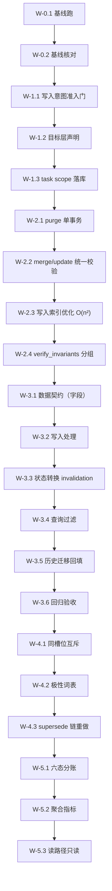

# DSH v0.3.0 完整实施计划书

> 依据：DSH_MEMORY_ARCHITECTURE_DESIGN_VNEXT.md（20 章，四项决策已拍板）
> 配套：DSH_v0.3.0_EXECUTION_RUNBOOK.md（详细执行手册，本文的逐工作包展开）
> 原则：本计划基于对当前实际代码的审计，不虚构路径/函数/字段；已决定与待裁决严格区分。

---

# 一、项目概述

## 1.1 v0.2.0 实际完成情况（已实现并经测试）

- OPS 单一事实源：engine/attune_memory/rpc.py 的 OPS dict（27 op）+ describe_ops + 启动自检。
- explicit 默认 False：engine/attune_memory/write.py 的 Candidate.explicit=False + 插件 tools.js schema 暴露。
- 删 forget hard：模型工具只软删，物理删除仅管理页/CLI 两段式。
- 抽取四计数：plugin/dsh-attune-memory/lib/index.js 的 extractAndStore（attempt/written/blocked/failed）。
- 死链闭合：/api/reads、/api/discarded（plugin/lib/routes.js）。
- 启动自检三态：plugin/lib/engine.js（ok/mismatch/unavailable，仅 ok 放行写）。
- 测试：engine 120 单测 / plugin 10 测试文件 / eval 24；CI plugin job 10 step。

## 1.2 v0.3.0 建设目标

**结构化记忆正确性**——把现有记忆系统"做对"：时态治理、职责分层、数据一致性、冲突判据、可观测性。对应 VNEXT 的 V1-1/V1-2/V1-4/V1-6/V1-7（+ V1-0 基线冻结）。

## 1.3 主要解决的问题（对应台账）

| V1 项 | 解决的问题（台账） |
|---|---|
| V1-0 基线冻结 | 缺改造前检索基线（#38 规模基准的一部分） |
| V1-1 时态治理 | #57 内容正确性、#48 过期记忆标长期有效、#49 supersede 方向反（时态部分）、#27 tick 无调度 |
| V1-2 职责分层 | #46 职责混层、#47 运行时状态污染、#14 全局 interaction 无通道、工作安排误记 |
| V1-4 冲突判据 | #49 措辞修正误 supersede、#11 同槽位多值 active、#10 个位数数值、#33 否定偏好 |
| V1-6 可观测性 | #52 注入指标与送达不一致、#54 always 零观测、#53 计数器不能倒推、#24 读路径污染 |
| V1-7 数据一致性 | #12 purge 非事务、#13/#35 merge 绕过 validate、#22 update 绕过生命周期、#37 未按 user_id、#30 秒级碰撞、#38 规模基准 |

## 1.4 本次明确不实施（边界）

- Raw-history RAG 检索（V1-3）→ v0.4.0，连同 MCP Server 解耦。
- V1 可选（source_quote、导出脱敏）、V2（Consolidation、revision CAS、多用户）、暂不引入（向量库/知识图谱/复杂 Agentic Memory/多层摘要/高频 Dreaming/自动人格推断/复杂评分/多套分类/情绪关系）、待实验（FTS5/倒排、结构化 embedding 语义候选、LLM 语义仲裁）——**均不进 v0.3.0**，未来重估条件见 VNEXT §3.4/§3.5/§3.6。

## 1.5 最终交付范围

- 六阶段工作包（见 WBS）全部完成并通过验收。
- 120 单测 + 10 测试文件 + eval 24 无回归。
- 外部基线复跑对比：LoCoMo 13.4% 不劣化、LongMemEval 可读。

## 1.6 发布与验收条件

- 全部阶段完成 + 回归通过 + 基线不劣化。
- 版本 bump、打包、上传等哥哥「上传/更新」指令。

---

# 二、当前系统状态审计（真实代码，非虚构）

## 2.1 目录与模块结构

- 引擎（Python）：engine/attune_memory/ 13 文件——util.py、text.py、const.py、db.py、store.py、search.py、write.py、read.py、manager.py、rpc.py、explain.py、memctl.py、__init__.py。
- 插件（JS）：plugin/dsh-attune-memory/lib/ 9 文件——message.js、client.js、engine.js、index.js、tools.js、routes.js、recall.js、extract.js、ui.js。
- 评测：engine/eval/（run_eval.py + external/ 十文件）、engine/tests/ 4 文件、plugin/test/ 10+ 文件。
- 三分区：engine/+plugin/（源码可脏）、clean/dsh-attune-memory/（git 仓库唯一上传源）、local/（运行镜像）。

## 2.2 核心代码入口

- 引擎主循环：engine/attune_memory/rpc.py 的 main()（stdin/stdout JSONL）→ handle(mem, req) → _call。
- 引擎门面：engine/attune_memory/manager.py 的 Memory 类（search/find_similar/read_for_context 等）。
- 插件接线：plugin/lib/index.js（宿主事件 → extractAndStore + read_for_context 注入）。
- CLI：engine/attune_memory/memctl.py。

## 2.3 数据库表结构与字段

engine/attune_memory/db.py：SCHEMA_VERSION="3"。memories 表 24 字段：

id / user_id / type / subtype / subject_type / subject_name / domain_key / content / keywords / confidence / importance / injection_policy / scope / status(active|superseded|archived|deleted) / source_message_id / source_conversation_id / valid_from / valid_until / superseded_by / created_at / updated_at / metadata / inject_count / use_count。

**关键缺口（v0.3.0 要补）**：无 temporal_kind、无 invalidation、无 event_date、无 last_verified。其余表：memory_change（变更流水）、meta、counter、observation、request（幂等）。索引 10 个：idx_mem_policy/type_domain/scope/subject/valid/superseded/updated/change_mid/obs_kind/req_created。

## 2.4 记忆读写调用链（现状）

写：Candidate → validate()（write.py）→ value_gate() → find_similar()（同槽位+邻近词）→ 决策表 → Store.tx() 单事务落库 + memory_change 流水。
读：read_for_context()（read.py:276）→ stable_items()（read.py:107）+ context_block()（search() + 领域约定补位）→ 组装 S1/S2/T。

## 2.5 检索与注入调用链（现状）

- 检索：search.py 的 search() → build_candidates()（search.py:165）→ 6 因子打分 Final = Relevance × Confidence × Importance × Freshness × ContextMatch × ConflictPenalty。
- 注入：read.py 的 stable_block()（C 通道，always 层）+ context_block()（T 通道，按状态/领域/历史三段预算）。
- **缺陷**：stable_items() 只过滤 confidence 和长度，**不过滤 is_expired**（#48）；只有 inject_count/use_count 两计数，**无六态分账**（#52/#54）。

## 2.6 宿主适配情况

- 插件挂 DSH：plugin/lib/index.js 通过 client.js 与 Python 引擎（engine/attune_memory/rpc.py）RPC 通信。
- 宿主耦合：无 MCP Server，DSH 接线即核心产品（#40/#41，v0.4.0 解耦）。

## 2.7 测试文件及覆盖

- engine/tests/：test_engine.py、test_rpc_reliability.py、verify_delivery.py、rpc_smoke.js。
- plugin/test/：e2e.test.mjs、extract-store.test.mjs、tools.test.mjs、routes.test.mjs、routes.stub.test.mjs、engine.test.mjs、extract.test.mjs、recall.test.mjs、panel.test.mjs、layout-guard.test.mjs + contract/ + lib/engine-pkg.mjs + lib/session-log.mjs。

## 2.8 已知缺陷（未解决台账，逐条对应 WBS）

见 §1.3 的表；完整 57 条映射见 VNEXT §5.1。

## 2.9 v0.2.0 已交付成果（保留，不回退）

SSOT / explicit 默认 False / 删 forget hard / 抽取四计数 / 死链闭合 / 启动自检三态 / CI 补测。v0.3.0 全部保留，不做回退。

---

# 三、工作分解结构 WBS

任务粒度原则：每个工作包有独立边界、独立测试、可独立回滚。命名 W-x.y（阶段.工作包），任务 T-xxx 在 RUNBOOK 里逐条展开。

## 阶段 0：基线冻结（V1-0）

| 工作包 | 内容 | 交付 |
|---|---|---|
| W-0.1 基线跑 | ✅ | 冻结快照 `/tmp/baseline-engine`（22 个 .py，指纹 `c14bd981b99c…`）；`.ext-runs/lme-baseline-full/` 20/20（`--haystack 0 --keywords bow`，harness `--jobs/--resume`，2754s）；report=`.ext-runs/lme-baseline-full.report.txt`（R@5 10.0%，随机基线 10.1%） |
| W-0.2 基线核对 | ✅ | `外部基准-W0.2-差异结论.md`：`haystack=0` 基线 10.0% → 新版 27.5%（+17.5pp），`haystack=20` 42.5% → 77.5%（+35pp）；`compare.py` 三处判"不劣化"（LongMemEval 变差 0 题；LoCoMo 变好 462 / 变差 85 / 持平 1430，变差已按"候选集换序 + MAX_CANDIDATES=200"逐类交代）；LoCoMo `bow` 13.4% → 24.4%（+11.0pp，@20 16.9% → 33.1%）；失败样例 5 条已落盘。附带修复：`report.py` 忽略 `run.json` 的 haystack（把 42.5% 算成 1.7%）；`build_candidates` 只取最近 200 条（R-2.3.5 回归用例） |

## 阶段 1：职责分层（V1-2）

| 工作包 | 内容 | 交付 |
|---|---|---|
| W-1.1 写入意图准入门 | 确定性排除规则（可从文件验证/含指代/一次性安排/否定极性） | 准入门模块 + 测试 |
| W-1.2 目标层声明 | rpc.py OPS 每 op 声明目标层（证据/事实/组装） | 契约 + 校验 |
| W-1.3 task scope 落库 | task scope 真实写入与检索通道 | 功能 + 测试 |

## 阶段 2：数据一致性 + 规模（V1-7）

| 工作包 | 内容 | 交付 |
|---|---|---|
| W-2.1 purge 单事务 | 软删+物理删+tombstone 原子 | 事务 + 测试 |
| W-2.2 merge/update 统一校验 | 走 validate + 生命周期 | 修复 + 测试 |
| W-2.3 写入索引优化 | near_keywords 全表扫 → 索引（O(n²)→近线性） | 索引 + 规模基准 |
| W-2.4 verify_invariants 分组 | 按 user_id 分组 + 高精度时间 | 修复 + 测试 |

## 阶段 3：时态治理（V1-1）

| 工作包 | 内容 | 交付 |
|---|---|---|
| W-3.1 数据契约 | db.py 加 temporal_kind/invalidation/event_date/last_verified 字段 + const.py 枚举 + store.py FIELDS | schema + 迁移 |
| W-3.2 写入处理 | Candidate 加字段 + write.py 落库 | 功能 + 测试 |
| W-3.3 状态转换 | invalidation 二分（corrected/superseded）+ supersede 链 | 功能 + 测试 |
| W-3.4 查询过滤 | read.py stable_items 过滤过期 + search.py 过滤 corrected | 修复 + 测试 |
| W-3.5 历史迁移 | 回填脚本（默认 current/None + superseded 回填） | 迁移脚本 + 校验 |
| W-3.6 回归验收 | 时态反例集（过期不注入/纠正 0 复活/as-of） | 测试 + 验收 |

## 阶段 4：冲突判据（V1-4）

| 工作包 | 内容 | 交付 |
|---|---|---|
| W-4.1 同槽位互斥 | same_slot 精确化 + 属性 key 级互斥 | 修复 + 测试 |
| W-4.2 极性词表 | 否定/废弃/沿用判定修正 | 修复 + 测试 |
| W-4.3 supersede 链重做 | 措辞修正不误触发；真变更才 supersede | 修复 + 测试 |

## 阶段 5：可观测性（V1-6）

| 工作包 | 内容 | 交付 |
|---|---|---|
| W-5.1 六态分账 | candidate/generated/rendered/delivered/visible/used 六计数 | 功能 + 测试 |
| W-5.2 聚合指标 | 指标带 schema/version/started_at/coverage | 功能 + 测试 |
| W-5.3 读路径只读 | 读路径不写 use_count（#24） | 修复 + 测试 |

## V1-5 独立验证体系（贯穿，专项工作包）

| 工作包 | 内容 | 交付 |
|---|---|---|
| W-EV1 规模基准+负向断言 | 500/1000/5000 规模基准 + 预注册负向断言集 | 基准脚本 + 断言集 |
| W-EV2 评测流程固化 | 四道闸 + UNVERIFIED + 第三方可复算进 CI | CI step + 检查单 |

## V1-3 Raw-history RAG（v0.4.0 预规划，本版不实施，仅展开规划）

| 工作包 | 内容 | 交付 |
|---|---|---|
| W-R1 原始历史索引 | embedding + 定位，DSH 不存原文 | 索引方案 |
| W-R2 语义检索管线 | 召回 + 混合 + 重排序 + 过滤 | 检索管线 |
| W-R3 词法打分退役 | 结构化检索退辅助 | 简化 |
| W-R4 证据与事实冲突仲裁 | 旧事实不覆盖当前 | 仲裁 |
| W-R5 MCP Server 解耦 | 宿主依赖根本解法 | 解耦 |

# 四、实施依赖关系

依赖顺序依据实际技术依赖（非 V1 编号顺序）：

依赖要点：
- W-0.1 无前置，可立即执行（已在跑）。
- 阶段 1（W-1.x）依赖基线冻结（阶段 0），因为职责分层要对照基线验证不劣化。
- 阶段 2 的 W-2.3（索引优化）完成后，补 50 题完整 haystack 基线，作为规模验证（对照 20 题口径）。
- 阶段 3 的 W-3.5（迁移）依赖 W-3.1（字段契约）和阶段 2（事务收口，保证迁移过程可回滚）。
- 阶段 4 依赖阶段 3（时态字段就绪后，冲突判据才能区分 corrected vs superseded）。
- 阶段 5 依赖阶段 1-4 全部（六态分账要覆盖所有写/读路径）。

# 五、阶段交付与质量门槛

每个阶段满足「通过条件」才允许进入下一阶段；未通过则回退修复，不跳过。

| 阶段 | 开始条件 | 输入 | 输出 | 通过条件 | 未通过处理 |
|---|---|---|---|---|---|
| 0 基线 | 无 | 数据 + 引擎 | lme-baseline-full 产物 | report UNVERIFIED + random 可读 + 差异结论 | 补跑/修口径 |
| 1 职责分层 | 基线冻结 | 准入门规则 + OPS | 准入门模块 + 契约 | 工作安排类不进事实层 + task scope 真实落库 | 回退该工作包 |
| 2 一致性+规模 | 阶段1 过 | 事务/索引设计 | 事务 + 索引 + 规模基准 | 规模基准近线性 + 120 单测不回归 + 50 题基线稳定 | 回退 + 修索引 |
| 3 时态治理 | 阶段2 过 | 字段契约 + 迁移 | 时态字段 + 过滤 + 迁移 | 过期不注入 + 纠正 0 复活 + 迁移幂等可回滚 | 回退迁移 |
| 4 冲突判据 | 阶段3 过 | 判据 + 极性词表 | 互斥 + supersede 链 | 措辞修正不 supersede + 同槽位不并存 | 回退判据 |
| 5 可观测性 | 阶段1-4 过 | 六态设计 | 六计数 + 指标 | delivered 与聚合一致 + always 有观测 + 读不写库 | 回退该工作包 |

# 六、数据迁移和兼容计划

- **旧数据**：memories 表 24 字段不动，新增 4 字段全部可空或带默认值。
- **新字段兼容**：temporal_kind TEXT DEFAULT 'current'；invalidation TEXT DEFAULT NULL；event_date TEXT NULL；last_verified TEXT NULL。
- **历史状态回填**：现有 status=superseded 的条目 → invalidation='superseded'（保守，无法区分纠正的按 superseded 处理）；active 条目 → temporal_kind='current'、invalidation=NULL。
- **索引构建**：新增 idx_valid_until（已有 idx_valid）、idx_event；CREATE INDEX IF NOT EXISTS，可在线加。
- **迁移失败**：迁移脚本幂等（可重跑）；每步写 memory_change 流水；失败回滚到迁移前快照。
- **备份**：迁移前复制 SQLite 文件（copy 到 .backup/）+ 记录 schema_version。
- **回滚**：字段默认值兼容 → 旧引擎可只读运行；删除新字段即可回退（数据不丢）。
- **用户记忆不丢失**：迁移只加字段/回填，不删不改原有 content/status/时间戳。

# 七、版本和发布计划

- **功能边界**：v0.3.0 只含六阶段（时态/职责/一致性/冲突/可观测），不含 Raw-history RAG 与 MCP Server（v0.4.0）。
- **兼容条件**：旧库可直接升级（新增字段默认值兼容）；公开 API 不破坏（只增不删）。
- **发布门槛**：全部阶段完成 + 回归通过（120 单测 + 10 测试文件 + eval 24）+ 外部基线不劣化（LoCoMo 13.4% + LongMemEval 可读）。
- **回滚条件**：发布后真机发现时态误判或写入回归，回退到 v0.2.0 快照（字段默认值兼容保证只读可用）。
- **设计书完成 ≠ 软件发布**：未实现能力不标记为正式功能；所有新字段/新行为在 RUNBOOK 验收通过前不宣称"已实现"。

---

# 八、实施进度（滚动记录）

> 口径：只有"代码 + 测试绿 + 证据留档"才记 ✅；只写了设计记 🚧。

| 工作包 | 状态 | 证据 |
|---|---|---|
| W-0.1 基线跑 | ✅ | 冻结快照 `/tmp/baseline-engine`（22 个 .py，指纹 `c14bd981b99c…`）；`.ext-runs/lme-baseline-full/` 20/20（`--haystack 0 --keywords bow`，harness `--jobs/--resume`，2754s）；report=`.ext-runs/lme-baseline-full.report.txt`（R@5 10.0%，随机基线 10.1%） |
| W-0.2 基线核对 | ✅ | `外部基准-W0.2-差异结论.md`：`haystack=0` 基线 10.0% → 新版 27.5%（+17.5pp），`haystack=20` 42.5% → 77.5%（+35pp）；`compare.py` 两处判"不劣化"，变差 0 题；失败样例 5 条已落盘。附带修复：`report.py` 忽略 `run.json` 的 haystack（把 42.5% 算成 1.7%）；`build_candidates` 只取最近 200 条（R-2.3.5 回归用例） |
| W-1.1 意图准入门 | ✅ | `write.intent_gate` + `const.FILE_VERIFIABLE_PATTERNS/RUNTIME_MARKERS/ONE_OFF_PATTERNS/NEGATION_STATE_VERBS/CORRECTION_MARKERS`；`tests/test_v030_stage1.py`（15 例） |
| W-1.2 目标层声明 | ✅ | `rpc.OpSpec.layer`（fact/assembly/evidence）+ `LAYERS` + 信封 `layer` 校验；describe 输出带 layer |
| W-1.3 task scope | ✅ | `store.query(task_key=)` + `read.stable_items` 跳过 task + 插件 `memory_remember.task_key` |
| W-2.1 purge 单事务 | ✅ | `write.purge`：单 tx + tombstone + 断链拒绝；`tests/test_v030_stage2.py` |
| W-2.2 merge/update 统一校验 | ✅ | `write.update/merge` 都过 `validate()`；update 的 `valid_until<=now` 触发归档 |
| W-2.3 写入索引 | ✅ | `memory_gram` 倒排 + `memory_gram_df`（df 最小的 gram 作入口）+ `COMMON_DF=200` 走 idx_mem_updated；基准 `eval/bench_write_scale.py`：500/1000/2000/4000/5000 = 0.93/2.01/4.66/11.45/15.80s（空载）；**per-write 增长 1.46×（门槛 <3.0）、5000 条 22.1s（上限 120s）**。检索侧也走倒排：`store.candidates_by_terms()`（按共现 gram 数排序，df>200 的公共 gram 不进 `IN`；`search()` 里再补 50 条最近写入兜底），修掉「候选=最近 200 条」的结构缺陷（复现：501 条时 `What degree did I graduate with?` 命中 0；回归用例 `R-2.3.5`，`test_v030_stage2.TestIndexedCandidates`）。门槛改用 per-write 增长而非逐段 doubling：并行跑外部基线时最后一段会被调度抖动放大到 3.2 倍，误报成退化 |
| W-2.4 invariants 分组 | ✅ | 按 user_id 分组 + 定宽毫秒时间戳 + 倒排完整性检查 |
| W-3.1 时态数据契约 | ✅ | schema `5`；`temporal_kind/invalidation/event_date/last_verified` + `idx_event`；`db.ensure_columns/migrate_data`（幂等） |
| W-3.2 写入四字段 | ✅ | `Candidate.temporal_kind/invalidation/event_date/last_verified` + validate 枚举/ISO/`event_date 仅 event` |
| W-3.3 invalidation 二分 | ✅ | `supersede(invalidation='corrected')` → 旧条 archived+corrected；默认 → superseded+superseded_by |
| W-3.4 查询过滤 | ✅ | `stable_items` 过滤过期；`build_candidates` 过滤 corrected；新增 `asof` 视图 |
| W-3.5 迁移脚本 | ✅ | `python -m memory.memctl migrate`；旧库 superseded 保守回填成 superseded |
| W-3.6 时态反例集 | ✅ | `tests/test_temporal.py`（14 例：过期不进稳定块 / as-of 可召回 / corrected 0 复活） |
| W-4.1 槽位互斥精确化 | ✅ | 单值槽位（identity/decision）多条 active 直接报；state 只有"同属性不同值"才判互斥；`key_values` 容忍"目前/现在"等副词 |
| W-4.2 极性词表 | ✅ | 插件 `preference` 规则把"不喜欢/不太喜欢"并进动词（修 #33 符号翻转）；identity 排除"我是一名学生"；测试见 `test_v030_stage4.py` + `extract.test.mjs` |
| W-4.3 supersede 链重做 | ✅ | `write._wording_fix`（LCS≥0.92 且非互斥且关键值不冲突）→ 就地 UPDATE，不新增不取代 |
| W-5.1 六态分账 | ✅ | `manager.metrics().funnel` = candidate/generated/rendered/delivered/visible/used |
| W-5.2 聚合指标信封 | ✅ | `schema=attune-memory.metrics/v1`、`version`、`started_at`（只写一次）、`coverage{injected_ratio,trace_ratio}` |
| W-5.3 读路径只读 | ✅ | `search(count_use=False)` 默认不写；`read_for_context` 不写；`updated_at` 不变 |
| W-EV1 规模基准 | ✅ | `eval/bench_write_scale.py`（n=500…5000，per-write 增长 + 最大样本耗时 + 逐段 doubling 参考值 + PASS/FAIL 退出码）；负向断言集见 `eval/gates.py` |
| W-EV2 评测固化 | ✅ | `eval/gates.py`（契约/场景/判分器/规模四闸，`--fast` 供本地）+ `v0.3.0-发布检查单.md`（含 UNVERIFIED 门槛与 predictions 要求）；CI step 归 发布执行窗口（`clean/.github` 不在 I6 允许我手改的范围） |
| V1-3 Raw-history RAG | — | v0.4.0 |

**当前回归口径（v0.3.0 中途）**：`python -m unittest discover -s tests -q` → **182 tests OK**；插件 10 个测试文件全绿；`python -m eval.run_eval` → **24/24**；`eval.bench_write_scale` → PASS。

**这一轮的关键判断（写下来免得以后重复踩）**
1. `near_keywords` 的 O(n) 不在"倒排有没有建"，而在**公共二元组的倒排链长度**：正文模板里的"要点""独立"每行都有，`gram IN (...) GROUP BY ... HAVING count` 仍要扫完整条链。解法是"每个 term 只取 df 最小的那个 gram 作入口"+"公共 gram 改走最近优先扫描"，df 存 `memory_gram_df` 由写入维护。
2. 时间精度从秒改到毫秒会**静默改变已有字符串比较的含义**：`"13:00:00Z" < "13:00:00.456Z"`（'Z' > '.'），插件侧 `turnStart` 必须同步保留毫秒，否则"本轮写过记忆"的窗口永远开在错误的一侧。
3. 时态二分不能靠 status 表达：`corrected`（原来记错）必须 archived 且永不召回，`superseded`（事实变了）要留在时间轴里给 as-of 用。混在一起时 as-of 查询会凭空少一段真实历史。
4. 措辞修正与事实变更必须机械区分：用 LCS 占比（≥0.92）+ 非互斥 + 关键值一致；只要有一条不满足就走新增/取代。宁可多一条记忆，也不要把两件事合成一条。

> 本文与 DSH_v0.3.0_EXECUTION_RUNBOOK.md 一一对应：WBS 里每个 W-x.y 在 RUNBOOK 有独立执行章节（任务背景/当前实现/目标设计/实施步骤/边界异常/测试设计/命令验证/迁移回滚/完成标准）。

